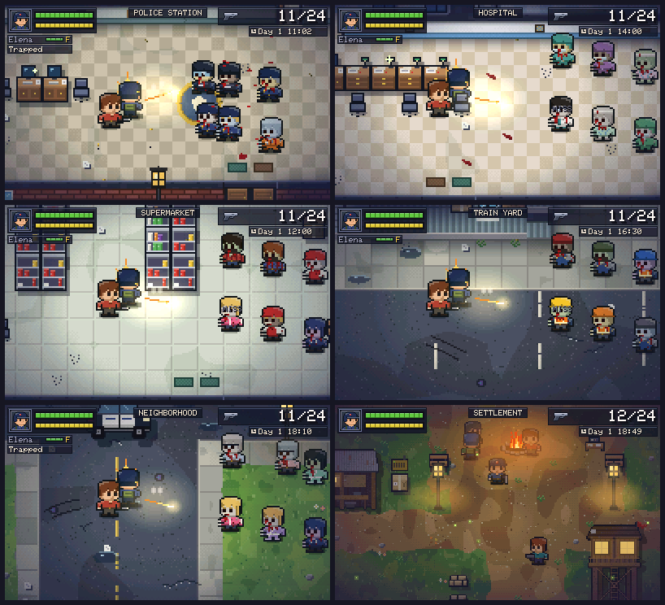
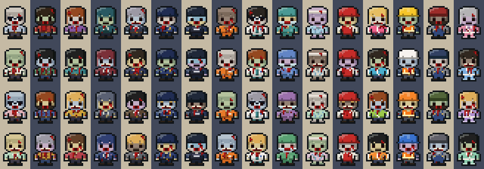
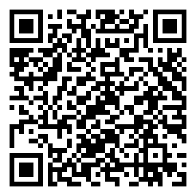

# Staying Alive (formerly Zombie Settlement)

A top-down pixel-art zombie survival and settlement-management game for **Windows PC** and **Nintendo 3DS**, built from one shared C++17 codebase.

Raid handcrafted locations, scavenge containers, organise a grid backpack, fight or avoid zombies, extract, and grow your settlement of survivors. Survivors die permanently.



The dead are whoever they used to be: officers, inmates and riot police in the station, doctors, nurses and patients in the hospital, shop staff and shoppers in the supermarket, yard crews in hard hats, neighbours in dressing gowns. Sixteen looks, four versions of each, and anyone from your settlement who turns keeps their own clothes.



A new game opens with a short scene at the camp fire and goes straight out on a first raid that teaches looting and fighting; back home, a tour of the six buildings ends with your first upgrade. The soundtrack is seven original pieces for a small synthesiser, one for the menus and one for each place, slow and written as horror score rather than as songs: a low drone, strings that slide into place a semitone wrong, and a sound that belongs to where you are (a heartbeat, a cell door, a heart monitor, a shop chime, a tolling bell, a music box running down).

These screenshots are from v0.4.0. The rules behind the look are in [docs/ART_DIRECTION.md](docs/ART_DIRECTION.md).

## Status

Early playable build. See [docs/DEVELOPMENT_ROADMAP.md](docs/DEVELOPMENT_ROADMAP.md) for exact per-feature status and [docs/KNOWN_ISSUES.md](docs/KNOWN_ISSUES.md) for limitations.

**Playable now:** settlement (5 survivors, 6 buildings, jobs, resources, recruitment, infirmary, workshop, stash), five places to raid (Police Station, Hospital, Supermarket, Train Yard, Neighborhood) with zombies, containers, keys and locked doors, survivor rescue and extraction, the grid inventory with stylus drag, rotation and stacking, day/night with a flashlight, infection and permanent death, incidents, a guided first raid, a soundtrack, and save/load.
**Not yet:** real-hardware verification of the 3DS build (frame rate and load times are unmeasured on a console), an FBI QR install test, and a listening test of the effects and the in-game mix. (The soundtrack was rewritten, slow and horror, after the owner found the first version too upbeat; the owner has listened to the new pieces and approved them.)

## Install

| Platform | File | How |
|---|---|---|
| Windows 10/11 x64 | `StayingAlive-Windows.zip` | Unzip anywhere, run `StayingAlive.exe`. No installer or runtime needed. |
| 3DS (Homebrew Launcher) | `StayingAlive-3DS.3dsx` | Copy to `sdmc:/3ds/`. |
| 3DS (HOME Menu) | `StayingAlive-3DS.cia` | Install with FBI. See [docs/FBI_INSTALLATION.md](docs/FBI_INSTALLATION.md). |

### FBI QR install (v0.3.0)



On a homebrew-capable 3DS: **FBI → Remote Install → Scan QR Code**, scan this code, confirm, then launch from the HOME Menu.
The code points directly at [`StayingAlive-3DS.cia`](https://github.com/JustGoodinc/zombie-settlement-3ds/releases/download/v0.3.0/StayingAlive-3DS.cia) (v0.3.0 release asset, 447 424 bytes). Not yet tested on a real 3DS. Details and fallbacks: [docs/FBI_INSTALLATION.md](docs/FBI_INSTALLATION.md).

Downloads: [latest release](https://github.com/JustGoodinc/zombie-settlement-3ds/releases/latest).

## Controls

| Action | 3DS | Windows (rebind in `%APPDATA%\ZombieSettlement\controls.ini`) |
|---|---|---|
| Move / face | Circle Pad | WASD |
| Fire | Y | Space / J / gamepad X / RT |
| Interact / search | A | E / K |
| Sprint (hold) / dodge (tap) | B | Shift |
| Reload | X | R |
| Lock facing | L | Q |
| Flashlight | R | F |
| Weapons / heal / squad orders | D-Pad L-R / Up / Down | Arrow keys |
| Inventory | SELECT | Tab / I |
| Pause | START | Esc |
| Touchscreen | Stylus | Mouse on the bottom screen |

Windows extras: F11 fullscreen, F12 screenshot, window scale in Settings.

## Build

```bash
# Windows (MSVC): game, tests, tool
scripts\build_windows.bat
# or with CMake
cmake -S . -B build -A x64 && cmake --build build --config Release
# Nintendo 3DS (devkitPro + devkitARM + libctru)
make
```

Tests: `build\zs_tests.exe`. Developer tool: `zs_tool --gallery DIR`, `--shots DIR`, `--bench`, `--icons DIR`, `--handoff DIR` (design handoff: every screen, every asset, audio, HTML + Markdown spec), `--playtest DIR` (a bot plays every map through the real input), and art review sheets: `--mapshots DIR`, `--combat DIR`, `--settlement DIR`, `--zombies DIR`.
Details: [docs/WINDOWS_BUILD.md](docs/WINDOWS_BUILD.md), [docs/NINTENDO_3DS_BUILD.md](docs/NINTENDO_3DS_BUILD.md).

## Licence

Code and all game assets: MIT, see [LICENSE](LICENSE). All art and audio are original and generated in code. No third-party game assets are used.
