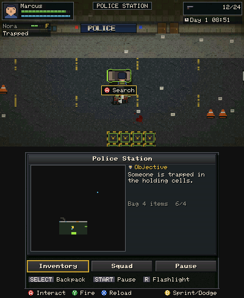
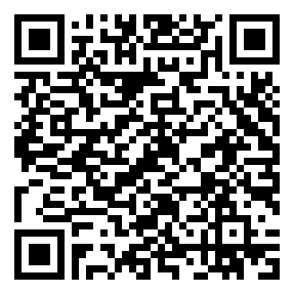

# Zombie Settlement

A top-down pixel-art zombie survival and settlement-management game for **Windows PC** and **Nintendo 3DS**, built from one shared C++17 codebase.

Run expeditions to handcrafted locations, scavenge containers, organise a grid backpack, fight or avoid zombies, extract, and grow your settlement of survivors. Survivors die permanently.



## Status

Early playable vertical slice (v0.1). See [docs/DEVELOPMENT_ROADMAP.md](docs/DEVELOPMENT_ROADMAP.md) for exact per-feature status and [docs/KNOWN_ISSUES.md](docs/KNOWN_ISSUES.md) for limitations.

**Playable now:** settlement (5 survivors, 6 buildings, jobs, resources, recruitment, infirmary, workshop, stash), the Police Station expedition (zombies, containers, keycard and cell doors, survivor rescue, extraction), the grid inventory with stylus drag, rotation and stacking, day/night with a flashlight, infection and permanent death, incidents, and save/load.
**Not yet:** the other six world-map locations (shown as "Unscouted"), real-hardware verification of the 3DS build, and an FBI QR install test.

## Install

| Platform | File | How |
|---|---|---|
| Windows 10/11 x64 | `ZombieSettlement-Windows.zip` | Unzip anywhere, run `ZombieSettlement.exe`. No installer or runtime needed. |
| 3DS (Homebrew Launcher) | `ZombieSettlement-3DS.3dsx` | Copy to `sdmc:/3ds/`. |
| 3DS (HOME Menu) | `ZombieSettlement-3DS.cia` | Install with FBI. See [docs/FBI_INSTALLATION.md](docs/FBI_INSTALLATION.md). |

### FBI QR install (v0.1.2)



On a homebrew-capable 3DS: **FBI → Remote Install → Scan QR Code**, scan this code, confirm, then launch from the HOME Menu.
The code points directly at [`ZombieSettlement-3DS.cia`](https://github.com/JustGoodinc/zombie-settlement-3ds/releases/download/v0.1.2/ZombieSettlement-3DS.cia) (v0.1.2 release asset, 400 832 bytes). Not yet tested on a real 3DS. Details and fallbacks: [docs/FBI_INSTALLATION.md](docs/FBI_INSTALLATION.md).

Downloads: [latest release](https://github.com/JustGoodinc/zombie-settlement-3ds/releases/latest).

## Controls

| Action | 3DS | Windows (rebind in `%APPDATA%\ZombieSettlement\controls.ini`) |
|---|---|---|
| Move / face | Circle Pad | WASD |
| Fire | Y | Space / J / gamepad X / RT |
| Interact / search | A | E / K |
| Sprint (hold) / dodge (tap) | B | Shift |
| Reload | X | R |
| Lock facing | L | Q |
| Flashlight | R | F |
| Weapons / heal / squad orders | D-Pad L-R / Up / Down | Arrow keys |
| Inventory | SELECT | Tab / I |
| Pause | START | Esc |
| Touchscreen | Stylus | Mouse on the bottom screen |

Windows extras: F11 fullscreen, F12 screenshot, window scale in Settings.

## Build

```bash
# Windows (MSVC): game, tests, tool
scripts\build_windows.bat
# or with CMake
cmake -S . -B build -A x64 && cmake --build build --config Release
# Nintendo 3DS (devkitPro + devkitARM + libctru)
make
```

Tests: `build\zs_tests.exe`. Developer tool: `zs_tool --gallery DIR`, `--shots DIR`, `--bench`, `--icons DIR`.
Details: [docs/WINDOWS_BUILD.md](docs/WINDOWS_BUILD.md), [docs/NINTENDO_3DS_BUILD.md](docs/NINTENDO_3DS_BUILD.md).

## Licence

Code and all game assets: MIT, see [LICENSE](LICENSE). All art and audio are original and generated in code. No third-party game assets are used.
