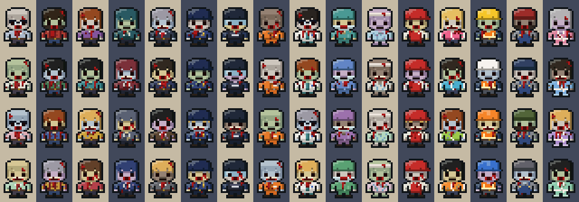

# Staying Alive — art direction (v0.4 visual overhaul)

The brief: stop measuring against our own mockups and look as good as the top-down shooters people
remember (Hotline Miami, Nuclear Throne, Enter the Gungeon), in menus as well as in play, with one style
across everything. This file records what was wrong, what the references do, and the rules the game follows now.

## What the references do (and we did not)

Looked at side by side with real frames of those games, the v0.3.0 build was:

- **Dim and muddy.** Interiors sat at about two-thirds brightness at noon and every shadow blended towards
  warm brown, so floors, walls and furniture merged into one grey-brown mass.
- **Noisy.** Every tile carried per-pixel static. The references use clean clusters of two or three tones and
  save contrast for things that matter.
- **Samey.** Every room used the same floor and wall. Hotline Miami gives each room its own loud floor, and you
  always know where you are.
- **Flat.** Furniture was drawn head-on while the world is three-quarter view. Walls had no depth.
- **Blocky light.** Lighting stepped in 8-pixel squares.
- **Quiet.** A shot was a small flash and a line. The references throw light, smoke, brass and blood, and leave
  the mess on the floor.
- **Mismatched menus.** The cloth-and-leather interface belonged to a different game from the world above it.

## The rules now

1. **One outline colour**: navy-black `rgb(22, 22, 34)` round characters, furniture, icons and interface blocks.
2. **Light comes from the upper left.** Every object is a lit top face over a darker front: wall tops with a
   bright rim, furniture, vehicles, and the menu buttons (a face with a lit edge and a darker front that it sinks
   into when pressed).
3. **Clean tones, no static.** Two or three flat tones per material, in clusters. Wear and stains are shapes.
4. **Every room has an identity.** Floors and wallpaper are picked from the room itself, per location:
   tan/olive/blue lino, walnut and navy carpet in the police station; mint, pale blue and cream in the hospital;
   big cream tiles under a red stripe in the supermarket; kitchen checker, warm woods, a different carpet and
   wallpaper in every room of every house; steel and concrete in the yard.
5. **Shadows are cool, never grey**: light fades towards navy by day, plum at dusk, deep blue at night, with
   smooth dithered falloff. Light sources add warm or coloured glow on top.
6. **Gold means "this one"**: focus, selection, interaction. Lime = can be searched / go. Red = danger.
7. **The fight leaves a mark.** Muzzle flashes light the room, casings stay where they fall, bullets chip walls,
   blood follows the shot and spatters the wall behind, pools spread, bodies stay.
8. **Places feel used**: pictures and notice boards on walls, door mats, daylight through windows, weeds at
   the foot of walls, puddles, cracks, tyre marks, manholes, a badge set into the police lobby floor, guide lines
   down the hospital corridor, lightbars still turning on abandoned cruisers, wrecks still burning, rain some days.
9. **The settlement is a neighbourhood**: two streets and an avenue; storage and workshop by the gate, the
   watchtower built into the wall beside it, kitchen by its garden, infirmary in the far corner, quarters at the back.
10. **The dead are whoever they used to be.** A zombie is a head (hair or headgear), an outfit, a skin tone and a
    wound, and the place decides who turns up: officers, riot police and inmates in the station; doctors, theatre
    nurses and patients in the hospital; shop staff and shoppers in the supermarket; hard hats and overalls in the
    yard; neighbours in dressing gowns and tracksuits. Sixteen looks, four versions of each, so a group in one
    uniform is still different people. Headgear and clothing carry the difference (the head is more than half of a
    16x24 figure); blood is an accent, one or two streaks, so it never hides the outfit. Someone from the settlement
    who turns keeps their own hair, clothes and backpack. Looks never change how a zombie plays.

## How it is built

| Part | File | Notes |
|---|---|---|
| Static level layer (floors, walls, fences, shadows, ground detail) | `src/gameplay/worldart.cpp` | Drawn once per level into one bitmap; each frame copies the visible rows. Permanent marks are stamped into it. |
| Furniture and vehicles | `src/gameplay/propart.cpp` | Three-quarter view, variants per map and position. |
| Characters and zombie looks | `src/core/art.cpp` | Hand-drawn parts (head, torso, legs) put together per pose. Zombie headgear, outfits and wounds are drawn over them; frames are made on first use and dropped when a level loads. Who appears where: `zombie_look()` in `src/gameplay/content.cpp`. |
| Inventory icons | `src/gameplay/itemart.cpp` | 12 px per grid cell, drawn at 2x in the starter bag. |
| Combat effects | `src/gameplay/fx.cpp` | Own random numbers; never touches gameplay state. |
| Lighting, glows, weather, HUD, title | `src/gameplay/render.cpp` | 8 px light lattice, bilinear, ordered dither; additive glows. |
| Interface kit | `src/ui/ui.cpp` | Slab, wells, block buttons, tabs, bars. |

Nothing here changes rules, timings, hit rolls or what the player can see of enemies. The muzzle-flash light and the
brighter remembered rooms are render-only; hidden zombies stay hidden.

## Cost

Measured on the PC benchmark (`zs_tool --bench`, `--bench-base`), where the 3DS frame budget was calibrated before:

| Scene | v0.3.0 | v0.4 |
|---|---|---|
| Police station, night, 60 zombies | 0.186 ms | about 0.16 ms |
| Settlement | 0.276 ms | about 0.2 ms |

Frames are cheaper than before because floors, walls, decals, ambient occlusion and furniture shadows are no longer
drawn every frame. The price is drawing the level layer once on entering a level (3–9 ms on PC; `zs_tool --bench-bake`)
and 1.8 MB of memory for it. Zombie frames are drawn the first time each one is shown (about 5 microseconds each on PC)
and dropped when a level loads, so memory follows what one level shows rather than all 96 variants; sixty zombies in
mixed looks render in the same time as sixty in four. None of this has been measured on a real 3DS.

## Review tools

`zs_tool --mapshots DIR` (every map: overview, arrival, middle, far end, night), `--combat DIR` (a staged firefight in
every location), `--zombies DIR` (every look, and the four versions of each), `--settlement DIR`, `--rain DIR`,
`--gallery DIR` (sprite sheets), `--handoff DIR` (every screen + asset export), `--tutorial DIR` (plays the whole tutorial and saves every stage), `--music DIR` (the soundtrack as WAVs with spectrograms and measurements).
