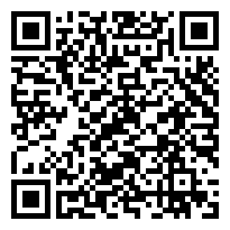

# Installing the .cia with FBI

Requires a homebrew-capable Nintendo 3DS with FBI installed (custom firmware). Install only on a 3DS you own.

## QR install
1. Open **FBI** on the 3DS.
2. Choose **Remote Install**.
3. Choose **Scan QR Code**.
4. Point the camera at the QR code (in the README or the release, on your PC or phone).
5. Confirm the install.
6. Wait for the CIA to download and install.
7. Return to the HOME Menu and launch **Staying Alive**.

The QR encodes the direct GitHub Release asset URL of `StayingAlive-3DS.cia`. GitHub serves release assets through an HTTPS redirect to its CDN. FBI follows redirects, but older FBI builds can fail on modern TLS. If the scan fails:

- **Manual install:** copy the `.cia` to the SD card, then in FBI go to SD → select the file → Install CIA.
- **Homebrew Launcher:** copy `StayingAlive-3DS.3dsx` to `sdmc:/3ds/`.

## Status (v0.4.1)

The QR encodes `https://github.com/JustGoodinc/zombie-settlement-3ds/releases/download/v0.4.1/StayingAlive-3DS.cia`. The release workflow downloaded that public URL and confirmed it is byte-identical to the uploaded CIA before generating the code, and a separate local check confirmed 302 → 200, 530 368 bytes. **A QR installation on real hardware has not been verified yet.**
