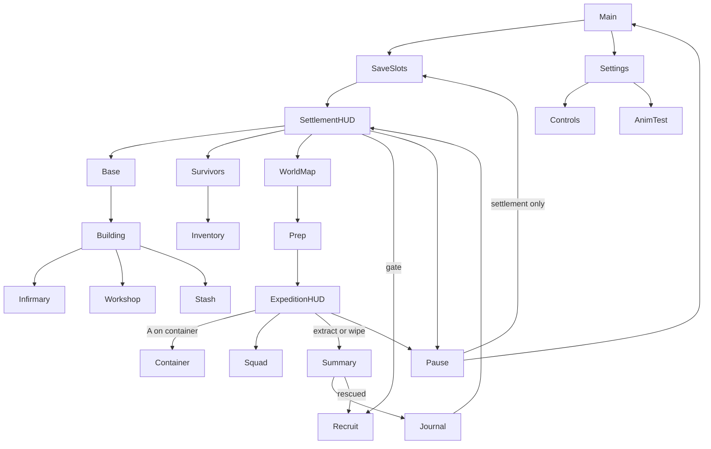

# UI Screen Index

All screens live in `src/ui/menus.cpp`. Every screen works with touch and with D-pad focus + A; B backs out (except HUD and Main).

| Panel | Reached from | Contents |
|---|---|---|
| Main | boot | New Game, Continue, Load, Settings, Controls, Credits, Quit (PC) |
| HUD (settlement) | default | resources, population/security, minimap, objective, Base / Survivors / Expedition / Journal / Inventory / Pause |
| HUD (expedition) | default | explored minimap, objective, bag info, Inventory / Squad / Pause |
| Pause | START | Resume, Inventory, Survivor Status, Options, Save (settlement only), Controls, Main Menu |
| Inventory | SELECT, HUD, Pause, Survivors→Backpack, Prep→Review | Grid / Equip / Items / Key tabs, Sort, Use/Equip, Rotate, Drop or To Stash |
| Container | search, dropped bag, Storage→Open Stash | slots, Take All, Take, Store, Inspect (or Donate at the stash), Back |
| Squad | HUD | Follow / Hold / Retreat per companion |
| Base | HUD | Base (buildings), Jobs, Resources (journal, stash) |
| Building | plot, Base→Manage | Build / Upgrade / Repair plus facility actions (Patients, Weapons, Stash, Guards, Farmers, Sleep, Rest) |
| Survivors | HUD, Pause | roster, skills, Set Leader, Backpack, Quarantine, Status (memorial) |
| Recruit | gate stranger, rescued survivor | Accept, Reject, Screen, Accept into Quarantine, Later |
| Infirmary | Building→Patients | Treat, Quarantine, Examine |
| Workshop | Building→Weapons, workbench | Repair, Upgrade |
| World Map | radio table, HUD | 7 locations, preview, loot, threat, cooldown, Deploy |
| Prep | World Map→Deploy | leader, companions, equipment, security warning, Deploy |
| Summary | extraction or wipe | results, rescued survivor, Return |
| Journal | HUD, Resources, after summary | paged history |
| Settings | Main, Pause | volumes, day length, shake, FPS, window scale/fullscreen (PC), Controls, Animation Test Room |
| Save/Load | Main, Pause | 3 slots, confirmations, damage reporting |
| Controls, Credits, Death, Animation Test | as named | |

Unscouted locations are listed but visibly disabled ("UNSCOUTED – Route not yet found") and Deploy is greyed out for them.

